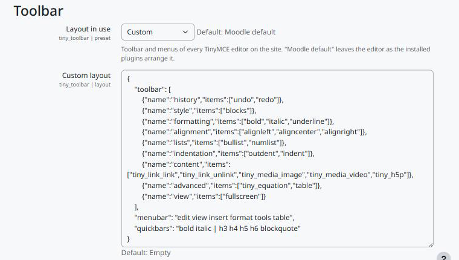

Configuration
=============

Go to *Site administration > Plugins > Text editors > TinyMCE editor > Toolbar* (search for "toolbar" in the administration).

   The Toolbar settings.

Layout in use
-------------

Moodle default
   The editor stays as the installed plugins arrange it. This is the value after installing.

Minimal
   Undo, redo, bold, italic, lists and link. No menus.

Simple
   Adds underline, image, video and equation. No menus. Good for forum posts and assignments.

Standard
   Paragraph styles, formatting, alignment, lists, indentation, link, media, H5P, equation, table and full screen, with the menus.

Accessibility
   A short toolbar with paragraph styles and the accessibility checker, and the menus that help to write accessible content.

Custom
   The custom layout below, usually written by the toolbar builder.

Custom layout
-------------

A JSON object:

.. code-block:: json

   {
       "toolbar": [
           {"name": "history", "items": ["undo", "redo"]},
           {"name": "formatting", "items": ["bold", "italic", "underline"]},
           {"name": "content", "items": ["tiny_link_link", "tiny_media_image"]}
       ],
       "menubar": "edit insert format",
       "quickbars": "bold italic | h3 h4 blockquote"
   }

``toolbar``
   List of groups (at most 30). Each group has a ``name`` and its ``items``, the button names (at most 50). Buttons of Moodle plugins have names such as ``tiny_link_link`` or ``tiny_media_image``; the builder shows them all.

``menubar``
   ``false`` for no menus, or a list of ``file``, ``edit``, ``view``, ``insert``, ``format``, ``tools``, ``table`` and ``help``.

``quickbars``
   Optional. The toolbar shown over selected text: button names separated by spaces, with ``|`` between groups, or ``false`` to turn it off. Without it, the editor keeps the Moodle selection toolbar. The editor never shows it in small text areas, and some Moodle buttons, such as the link button, do not appear in it.

The layout is checked on save and stored normalised. A button that does not exist on the site is simply not shown.

Capability
----------

``tiny/toolbar:use`` (allowed to every role by default)
   Users without it keep the Moodle default toolbar. Prohibit it for a role to leave that role out of the layout.
