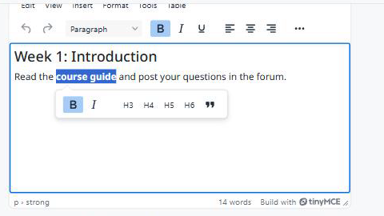

moodle-tiny_toolbar
===================

**Escolha a barra de ferramentas e os menus de todos os editores TinyMCE do seu Moodle, com modelos prontos ou um construtor visual.**

   Editor com barra e barra de seleção personalizadas.

* **O controle de barra que o Atto tinha.** O TinyMCE do Moodle só deixa o administrador ligar ou desligar plugins inteiros. Este plugin escolhe quais botões aparecem, em que ordem e grupos, e quais menus.
* **A palavra final.** A barra é aplicada depois que todos os outros plugins do editor colocaram os seus botões, então é exatamente o que o usuário vê.
* **Modelos e construtor.** Comece de um modelo (mínimo, simples, padrão, acessibilidade) ou monte a barra com os botões que o site tem de fato.
* **Por papel.** Usuários sem a permissão ``tiny/toolbar:use`` ficam com o padrão do Moodle.

English version: `English <../en/index.html>`_.

.. toctree::
   :maxdepth: 2
   :caption: Conteúdo

   installation
   configuration
   usage

Principais recursos
-------------------

* Barra em uso para o site todo: padrão do Moodle (sem mudança), mínima, simples, padrão, acessibilidade ou personalizada.
* Barra personalizada em JSON, conferida ao salvar: grupos da barra, menus e barra de seleção.
* Construtor com os botões registrados no site, grupos, ordenação, arrastar e soltar, menus, barra de seleção e editor de pré-visualização.
* Sem tabelas no banco e sem dados pessoais.
* **Moodle 4.5 LTS e 5.3 LTS**: testado numa matriz de CI com PostgreSQL e MariaDB.

Links
-----

* Código-fonte e issues: https://github.com/moodle-by-kelsoncm/tiny_toolbar
