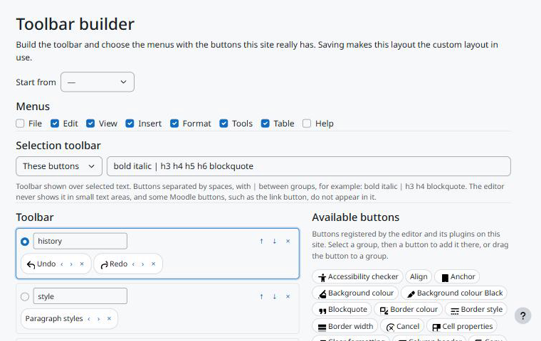

Uso
===

Construtor da barra
-------------------

Acesse *Administração do site > Plugins > Editores de texto > Editor TinyMCE > Toolbar builder*, ou use *Open the toolbar builder* nas configurações do Toolbar.

   O construtor da barra.

1. Em *Start from*, escolha um modelo, ou mantenha a barra em uso.
2. Marque os *Menus* que devem aparecer.
3. Escolha a *Selection toolbar* (barra de seleção): padrão do Moodle, desligada ou os botões que você digitar.
4. Monte a *Toolbar*:

   * selecione um grupo pelo botão de opção e clique num botão disponível para acrescentá-lo ali, ou arraste o botão para qualquer grupo;
   * mova botões com ‹ e ›, grupos com ↑ e ↓, e remova-os com ×;
   * *Add group* cria um grupo vazio; renomeie os grupos como quiser (letras, números, hífen e sublinhado).

5. *Save changes*. A barra vira a barra personalizada e a barra em uso, e o editor de pré-visualização no fim da página passa a mostrá-la.

Os botões disponíveis vêm dos editores e plugins instalados no site. Um botão com borda tracejada está na barra mas não existe no site (por exemplo, de um plugin desabilitado); ele não aparece no editor.

O que o usuário vê
------------------

Todos os editores TinyMCE do site usam a barra: descrições de cursos e atividades, fóruns, tarefas, páginas e assim por diante. Quem não tem ``tiny/toolbar:use`` fica com o padrão do Moodle. Para voltar ao padrão do Moodle para todos, escolha *Moodle default* como barra em uso.
